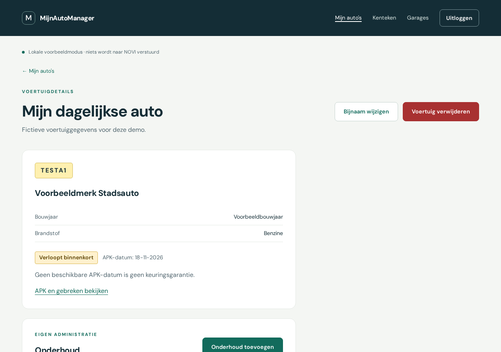

# MijnAutoManager

Eindopdracht Frontend (NOVI Hogeschool). Een React-webapplicatie waarin je je eigen auto's bijhoudt: onderhoud vastleggen, de APK-datum en geregistreerde gebreken bekijken en een erkend bedrijf in de buurt zoeken.

## Inhoudsopgave

1. [Inleiding](#inleiding)
2. [Screenshot](#screenshot)
3. [Benodigdheden](#benodigdheden)
4. [De applicatie draaien](#de-applicatie-draaien)
5. [Overige commando's](#overige-commandos)
6. [Testgebruikers en demogegevens](#testgebruikers-en-demogegevens)
7. [Gebruikte API's](#gebruikte-apis)
8. [Bekende beperkingen](#bekende-beperkingen)
9. [Broncode](#broncode)

## Inleiding

Autobezitters bewaren onderhoudsbonnen vaak los: in een la, in een mail of helemaal niet. MijnAutoManager zet alles per auto bij elkaar:

- **Mijn auto's**: een overzicht van je eigen voertuigen, met de APK-status in tekst ("Verloopt binnenkort", "Vervaldatum verstreken", ...).
- **Onderhoud**: beurten toevoegen, bewerken en verwijderen, met datum, omschrijving, kilometerstand en eventueel kosten, garage en notities.
- **APK en gebreken**: de APK-vervaldatum en de bij de RDW geregistreerde gebreken van een kenteken, met de meest voorkomende gebreken.
- **Garages zoeken**: erkende bedrijven zoeken op plaats en RDW-erkenning (bijvoorbeeld "APK Lichte voertuigen").

Accounts, voertuigen en onderhoud staan in de NOVI Educational Backend. Voertuiggegevens, APK, gebreken en bedrijven komen live uit RDW Open Data.

## Screenshot



## Benodigdheden

- [Node.js](https://nodejs.org/) versie 20 of hoger (getest met Node 22) en npm
- Een moderne browser (Chrome, Firefox, Edge of Safari)
- Een `.env`-bestand in de map `frontend` met deze twee variabelen (zie `.env.example`):

| Variabele | Waarde | Uitleg |
|---|---|---|
| `VITE_NOVI_URL` | `https://novi-backend-api-wgsgz.ondigitalocean.app` | Adres van de NOVI Educational Backend |
| `VITE_NOVI_PROJECT_ID` | `d153089f-ba2d-4564-912c-4204900eec14` | Project-id van deze opdracht; gaat mee als header `novi-education-project-id` |

Let op: alle `VITE_`-variabelen komen in de browsercode terecht. Zet hier dus nooit wachtwoorden of tokens in. RDW Open Data heeft geen sleutel nodig.

## De applicatie draaien

1. Clone de repository en ga naar de map `frontend`:
   ```bash
   git clone https://github.com/ceylanaa/mijnautomanager-2.0.git
   cd mijnautomanager-2.0/frontend
   ```
2. Installeer de packages:
   ```bash
   npm install
   ```
3. Maak het `.env`-bestand aan:
   ```bash
   cp .env.example .env
   ```
   Vervang daarna `jouw-novi-project-id` door de project-id uit de tabel hierboven.
4. Start de ontwikkelserver:
   ```bash
   npm run dev
   ```
5. Open **http://localhost:5173** in je browser. Gebruik echt `localhost` en niet `127.0.0.1`: NOVI staat alleen `http://localhost:5173` toe (CORS).

## Overige commando's

| Commando | Wat het doet |
|---|---|
| `npm run dev` | Start de ontwikkelserver op http://localhost:5173 |
| `npm run build` | Maakt een productieversie in de map `dist` |
| `npm run preview` | Bekijkt de productieversie lokaal op http://localhost:5173 |
| `npm test` | Draait de tests (Vitest en React Testing Library) |

## Testgebruikers en demogegevens

**Lokale demo (zonder account):** klik op de inlogpagina op **Bekijk de lokale demo**. Je bent dan ingelogd als demogebruiker. Alles wordt alleen in `sessionStorage` van dit tabblad bewaard en er gaat niets naar NOVI.

**NOVI-account:** maak zelf een account aan via **Registreren** en log daarna in. Er staan bewust geen wachtwoorden in deze README; een testaccount voor de beoordeling wordt apart aangeleverd.

**Fictieve kentekens:** alleen deze demovoertuigen kunnen worden opgeslagen, zodat er geen echte kentekens van anderen in de database komen:

| Kenteken | Voorbeeld | APK-datum |
|---|---|---|
| `TESTA1` | Stadsauto | over 20 dagen ("Verloopt binnenkort"), met fictieve gebreken |
| `TESTA2` | Weekendauto | geen datum ("APK-datum niet beschikbaar") |
| `TESTB1` | Familieauto | over 200 dagen |

Echte kentekens kun je wel opzoeken (keuze "RDW bekijken (alleen lezen)" op de pagina Kenteken) en de APK en gebreken ervan bekijken, maar niet opslaan. Voorbeelden: `J588LK` of `H137HN`.

## Gebruikte API's

- [NOVI Educational Backend](https://novi-backend-api-wgsgz.ondigitalocean.app): `/api/users`, `/api/login`, `/api/vehicles`, `/api/maintenance` en `/api/vehicles/{id}/maintenance`
- [RDW Open Data](https://opendata.rdw.nl/):
  - `m9d7-ebf2`: gekentekende voertuigen (merk, model, APK-vervaldatum)
  - `8ys7-d773`: brandstof
  - `a34c-vvps`: geconstateerde gebreken
  - `hx2c-gt7k`: omschrijvingen van gebrekcodes
  - `5k74-3jha`: erkende bedrijven
  - `nmwb-dqkz`: erkenningen per bedrijf

Een uitgebreidere uitleg staat in het [verantwoordingsdocument](verantwoordingsdocument.md).

## Bekende beperkingen

- Alleen de fictieve demokentekens kunnen worden opgeslagen.
- NOVI controleert niet zelf wie de eigenaar van een voertuig is; de app filtert op de ingelogde gebruiker.
- Verwijderen van een voertuig met onderhoud gebeurt in losse stappen en is daardoor niet "alles of niets".
- Er is geen wachtwoordherstel en geen afstandsberekening of afspraakreservering bij garages.

## Broncode

GitHub: https://github.com/ceylanaa/mijnautomanager-2.0
